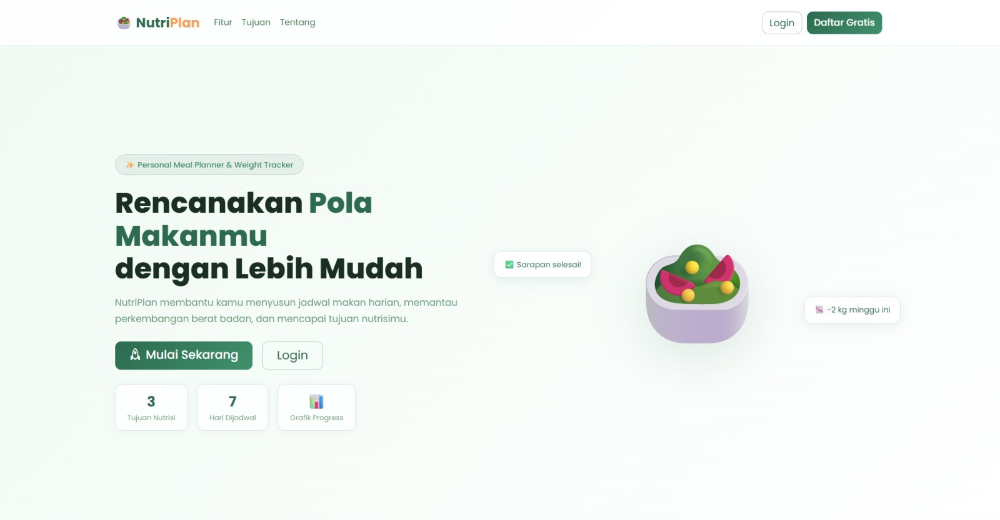
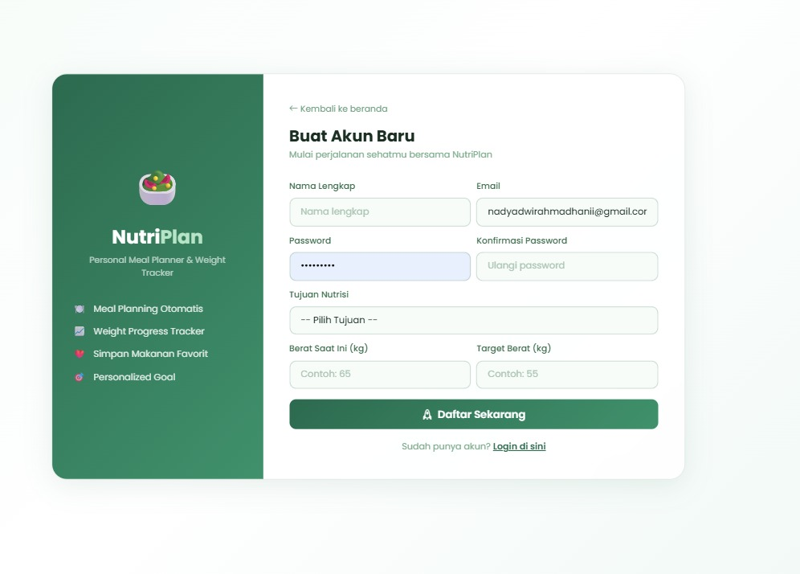
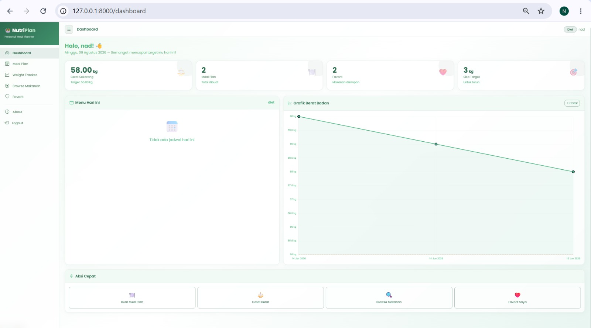

# 🥗 NutriPlan - Website "Personal Meal Planner & Weight Tracker"

Aplikasi web berbasis Laravel yang membantu pengguna merencanakan pola makan sesuai tujuan nutrisi (menurunkan berat badan, menjaga berat badan, atau menambah berat badan), sekaligus memantau perkembangan berat badan secara berkala.

---

##  Tentang Aplikasi

NutriPlan menyelesaikan masalah umum yang dihadapi banyak orang saat menjalani program kesehatan: kesulitan menyusun menu makanan teratur, menentukan jadwal makan harian, memantau perkembangan berat badan, dan menjaga konsistensi pola makan.

Sistem membantu menyusun jadwal makan harian dan mingguan, serta menyediakan fitur pencatatan perkembangan berat badan yang divisualisasikan dalam bentuk grafik.

---

##  Fitur Utama

- Meal Planning — Buat dan kelola jadwal makan mingguan dengan template otomatis berdasarkan tujuan nutrisi
- Weight Tracker — Catat dan pantau perkembangan berat badan dengan grafik interaktif dari waktu ke waktu
- Favorite Foods — Simpan makanan favorit sebagai referensi cepat saat menyusun meal plan
- Browse Makanan — Cari dan filter makanan berdasarkan kategori, nama, atau kandungan kalori
- Personalized Goals — Template meal plan otomatis menyesuaikan tujuan nutrisi pengguna (Diet, Maintenance, Bulking)
- Dashboard — Ringkasan progress: berat badan saat ini, jumlah meal plan aktif, makanan favorit, dan sisa target berat badan

---

##  Tech Stack

- **Laravel 12** — backend framework (PHP)
- **Laravel Breeze** — authentication scaffolding
- **Blade** — templating engine
- **MySQL** — database (dikelola via phpMyAdmin)
- **Vite** — asset bundling
- **Tailwind CSS** — styling

---

##  Database Structure

Database `db_nutriplan` terdiri dari beberapa tabel utama:

| Tabel | Fungsi |
|---|---|
| `users` | Data pengguna dan autentikasi |
| `foods` | Data makanan (nama, kalori, dll) |
| `food_categories` | Kategori makanan |
| `favorite_foods` | Makanan favorit tiap pengguna |
| `meal_plans` | Rencana makan pengguna |
| `meal_schedules` | Jadwal makan harian/mingguan |
| `weight_logs` | Riwayat pencatatan berat badan |

---

##  How to Run (Local Setup)

Aplikasi ini membutuhkan environment **PHP + MySQL**, dijalankan secara lokal menggunakan XAMPP dan Laravel Artisan.

### Requirements
- PHP >= 8.2
- Composer
- XAMPP (Apache + MySQL) atau MySQL standalone
- Node.js & NPM

### Langkah Instalasi

1. Clone repository ini ke folder `htdocs` (jika pakai XAMPP) atau folder project kamu:

git clone https://github.com/nadya-rahmadhani/nutriplan.git
cd nutriplan

2. Install dependency PHP:

composer install

3. Install dependency JavaScript:

npm install

4. Copy file environment:

cp .env.example .env

Sesuaikan konfigurasi database di `.env`:

DB_DATABASE=db_nutriplan
DB_USERNAME=root
DB_PASSWORD=

5. Generate application key:

php artisan key:generate

6. Nyalakan XAMPP (Apache & MySQL), lalu buat database `db_nutriplan` melalui phpMyAdmin

7. Jalankan migration untuk membuat struktur tabel:

php artisan migrate

8. Jalankan development server:

php artisan serve

Buka aplikasi di `http://127.0.0.1:8000`

9. (Opsional) Jalankan Vite untuk hot-reload asset:

npm run dev

---

## 📸 Screenshot

### Landing Page

### Register

### Dashboard

---

## 👤 Author

**Nadya Dwi Rahmadhani** — Mahasiswa S1 Sistem Informasi, Institut Teknologi Sepuluh Nopember (ITS)

- [LinkedIn](https://www.linkedin.com/in/nadyadwirahmadhani/)
- [GitHub](https://github.com/nadya-rahmadhani)
